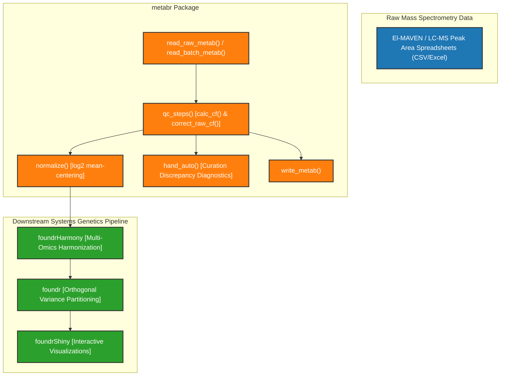

# Developer Guide for metabr

Welcome to the developer guide for **metabr** (v0.2.4), an R package designed for metabolite data ingestion, quality control (QC) batch correction, normalization, and curation discrepancy analysis for metabolomics data (Kibbey Lab / Attie Lab systems genetics).

This document details package architecture, data models, developer environment setup, core QC batch-correction algorithms, S3 class definitions, and verification procedures.

---

## 1. Ecosystem & Package Architecture

`metabr` serves as the metabolite data ingestion and standardization layer. It takes raw peak-area spreadsheets output by El-MAVEN or LC-MS platforms, applies quality control sample batch corrections across runs, plates, and batches, and outputs standardized datasets for downstream analysis.

### Role in the Systems Genetics Pipeline



### Key R Functions & Modules

| Module / File | Core Functions | Description |
| --- | --- | --- |
| [`R/qc_steps.R`](R/qc_steps.R) | `qc_steps()`, `calc_cf()`, `replace_missing_ave_cf()`, `correct_raw_cf()` | Core quality control batch-correction engine using plate QC pool sample ratios |
| [`R/read_raw_metab.R`](R/read_raw_metab.R) | `read_raw_metab()` | Ingests raw LC-MS peak-area tables; parses traits and sample identifiers (`mouse_id`, `run`, `rundate`, `Batch`, `Plate`, `time`, `rep`) |
| [`R/read_batch_metab.R`](R/read_batch_metab.R) | `read_batch_metab()` | Parses previously batch-corrected multi-sheet Excel files |
| [`R/read_metab.R`](R/read_metab.R) | `read_metab_minute()` | Ingests minute-specific time-course metabolomics experiments |
| [`R/write_metab.R`](R/write_metab.R) | `write_metab()` | Exports long-format metabolite tibbles into standardized wide CSV files |
| [`R/norm_merge.R`](R/norm_merge.R) | `normalize()` | Applies compound-wise mean-centering and $\log_2$ transformation |
| [`R/hand_auto.R`](R/hand_auto.R) | `hand_auto()`, `ggplot_hand_auto()`, `autoplot.hand_auto()` | S3 class and ggplot methods to compare manual vs. automated curation ratios |

---

## 2. Developer Environment & Setup

### Prerequisites

- **R Version**: $\ge 3.5.0$
- **Core Dependencies**: `dplyr`, `ggplot2`, `knitr`, `readr`, `purrr`, `stringr`, `tibble`, `tidyr`, `utils`, `readxl`, `rlang`
- **Optional Suggests**: `EnrichmentBrowser`, `OmnipathR`

### Development Workflow

```r
# 1. Load active package development session
devtools::load_all()

# 2. Update roxygen2 documentation & NAMESPACE
devtools::document()

# 3. Run package check
devtools::check(cran = FALSE)
```

> [!NOTE]
> All Git operations (status, diff, branch, checkout, staging, commit, push) are reserved for the user to execute manually.

---

## 3. Core Quality Control Methodology

The core pipeline operation in `metabr` is plate-level quality control (QC) batch correction driven by `qc_steps()`.

### Mathematical Correction Formula

For a given compound $c$ (and retention time $\text{medRt}$ for untargeted assays) measured in batch $b$ and plate $p$:

1. **Calculate Plate QC Mean**:
   $$\bar{y}_{b, p, c, \text{QC}} = \frac{1}{N_{\text{QC}}} \sum_{i \in \text{QC}_{b,p}} y_{i, c}$$

2. **Calculate Global Compound QC Mean**:
   $$\bar{y}_{c, \text{QC}} = \frac{1}{N_{\text{total QC}}} \sum_{\text{all QC}} y_{i, c}$$

3. **Correction Factor (CF)**:
   $$\text{CF}_{b, p, c} = \frac{\bar{y}_{b, p, c, \text{QC}}}{\bar{y}_{c, \text{QC}}}$$

4. **Batch-Corrected Sample Intensity**:
   $$y_{\text{corrected}, i} = \frac{y_{\text{raw}, i}}{\text{CF}_{b, p, c}}$$

If a plate QC mean is missing for a compound, `replace_missing_ave_cf()` computes the average correction factor across available plates to prevent missingness propagation.

---

## 4. Analysis & Diagnostic Workflows

The repository includes several analysis workflows and vignette notebooks:

- [`QC_Automation.Rmd`](QC_Automation.Rmd): Unified, parameterized QC batch-correction pipeline configurable by batch date (`params$batch_date`).
- [`QC_Automation_2023.Rmd`](QC_Automation_2023.Rmd): Historical benchmark on Founder Plasma validating automated correction against human curation (`hand_auto()`).
- [`QC_Automation_2025.Rmd`](QC_Automation_2025.Rmd): Automated batch correction on Diversity Outbred (DO) liver tissues.
- [`QC_steps.Rmd`](QC_steps.Rmd): Detailed step-by-step walkthrough of QC pool calculations and correction factors.
- [`QC_check.Rmd`](QC_check.Rmd): Diagnostic verification of batch correction outcomes.
- [`elmaven.Rmd`](elmaven.Rmd): Peak-area table parsing and El-MAVEN output structure evaluation.

---

## 5. Vignettes & Documentation Suite (`vignettes/devel_guide/`)

The documentation suite configured for the `pkgdown` website (`https://byandell-sysgen.github.io/metabr`) includes:

- [`vignettes/devel_guide/index.Rmd`](vignettes/devel_guide/index.Rmd): Developer Guide Overview & Architecture.
- [`vignettes/devel_guide/qc_pipeline.Rmd`](vignettes/devel_guide/qc_pipeline.Rmd): QC Pipeline & Correction Methodology.
- [`vignettes/devel_guide/data_ingestion.Rmd`](vignettes/devel_guide/data_ingestion.Rmd): Data Ingestion & IO Format Specifications.
- [`vignettes/devel_guide/datasets.Rmd`](vignettes/devel_guide/datasets.Rmd): QC Datasets & Directory Organization (replacing root `datasets.md`).
- [`vignettes/devel_guide/deployment.Rmd`](vignettes/devel_guide/deployment.Rmd): CI/CD & Site Deployment Walkthrough.
- [`vignettes/devel_guide/refactor.Rmd`](vignettes/devel_guide/refactor.Rmd): Package Refactoring & Data Reorganization.
