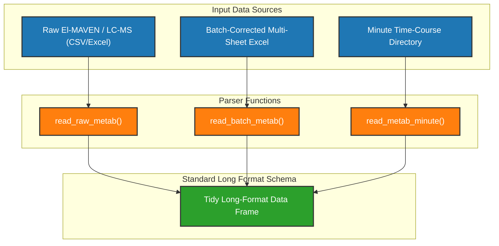

```{r, include = FALSE}
knitr::opts_chunk$set(
  collapse = TRUE,
  comment = "#>"
)
```

# Data Ingestion & IO Format Specifications

This document outlines the file format requirements, column parsing rules, and data frame schemas used throughout **metabr**.

---

## 1. Input Data Formats & Loaders



### Batch Directory Organization

Metabolite data transfers are stored by dated drops under `data/"QC Batch Correction"` (documented in [`datasets.Rmd`](datasets.html)):

- **`20231127/` (Founder Plasma)**: Contains raw CSVs in `#Founder_Plasma_Raw_Data/` and hand-calculated reference workbooks in `#Founder_Plasma_Batch_Corrected_Data/`.
- **`20251112/` (DO Livers)**: Raw CSVs in `2025_Nov_Raw/` (featuring `(in)` input indicators and `min1000` minimum area flags).
- **`20261020/` (DO Plasma)**: Raw/corrected CSVs in `DO_Plasma_tar_untar_metab_For_Batch_Correction/`.

---

## 2. Standard Tidy Long-Format Data Schema

All loader functions in `metabr` convert raw wide spreadsheets into a standardized long-format data frame containing the following key attributes:

| Column Name | Data Type | Description |
| --- | --- | --- |
| `sample` | `character` | Full sample identifier string (e.g. `run01-08Jul26_M101_15min_1_pos`) |
| `compound` | `factor` | Metabolite name |
| `medRt` | `numeric` | Median retention time in minutes (present in untargeted assays) |
| `value` | `numeric` | Peak area intensity or AUC value |
| `mouse_id` | `character` | Animal subject identifier extracted from sample string |
| `run` | `character` | Mass spectrometry run index |
| `rundate` | `Date` | Run date parsed from sample header |
| `Batch` | `character` / `integer` | Analytical batch number |
| `Plate` | `character` / `integer` | 96-well plate identifier |
| `time` | `character` | Sampling timepoint (e.g. `15min`) |
| `rep` | `character` | Technical replicate index |

---

## 3. Data Export (`write_metab`)

Processed and normalized long-format metabolite data frames are exported into standardized wide-format CSV spreadsheets using `write_metab()`:

```r
# Export targeted data frame to wide-format CSV
write_metab(rescale_HCneg, "data/QC Batch Correction/20261020/Automated/HC_Neg_Targeted.csv")

# Export untargeted data frame (preserves compound and medRt)
write_metab(
  rescale_HCnegU,
  "data/QC Batch Correction/20261020/Automated/HC_Neg_Untargeted.csv",
  target = FALSE
)
```
